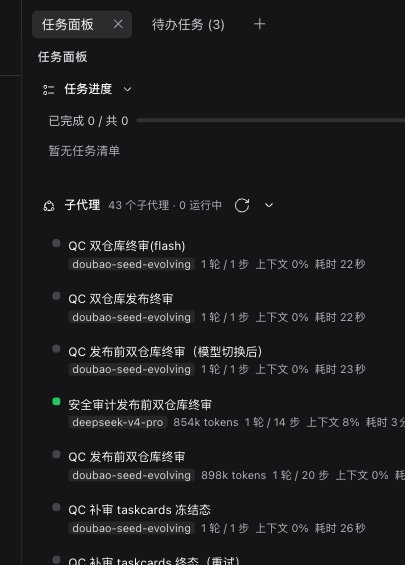

# dsh-ui-taskpanel

<p align="center">
  <a href="https://github.com/ydlly224/dsh-ui-taskpanel"></a>
  
  
  <a href="https://github.com/topics/dsh-plugin"></a>
</p>

<p align="center"></p>

DSH（DeepSeek Harness）Web UI 的纯客户端插件：**官方右侧栏原生标签页「任务面板」**（`sidebarRightTabs` 注册类型 + `sidebar.right.pane.tab` 槽位，与「工作区文件/浏览器/终端」同一套 dock 体验：可拖拽分栏、全屏、宽度拖拽、会话级布局记忆），聚合当前会话的三类运行信息。

> 兼容性：DSH Web 0.1.x ~ 0.2.x（依赖官方 `sidebarRightTabs` 服务与 `sidebar.right.pane.tab` 槽位；在 0.2.1-rc.2 上验证）。纯客户端 bundle，无 npm 依赖。

- **任务进度清单** — 当前会话的 todo 投影（`projectionValues.todos`，兼容数组与 `{items}` 两种形态），`in_progress → pending → completed` 排序；进度条 + "已完成 N / 共 M" + "进行中 X · 待办 Y" 计数；会话不具备该能力（键缺失）时面板隐藏。
- **子代理运行状态** — 当前会话的直接子代理（`origin === "subagent"` 且 `parentId === current`）；每行展示**模型芯片、token 用量、轮次/步数、上下文占用%、耗时**（读取 0.2.1 的 `tokenUsage` / `sessionStats` / `contextPressure` / `subagentTiming` / `modelSelection` / `subagent.label` 投影）；运行中置顶、其余按更新时间倒序；超过 8 行分页"显示其余 N 个"；**默认点击在右侧栏打开子代理会话**（官方原生 `subagentchat` 资源：`dsh-resource://subagentchat/session/<childSessionId>?parent=…&mode=…`，经 `sidebarRight.openResource(resource, { kind: "subagentchat", preferNewPane: true })`，与官方 `openChildAside` 同款），**Alt/⌘ 点击在主视图打开**；回退链 `openSubagentAside` → `uiWorkspace.openSession`（旧宿主回退 `sessions.openSubagent`）；面板可见时 `setSubagentCatalogOpen` 订阅目录推送 + 手动刷新。
- **后台运行任务** — 0.2.1 `jobs` 服务快照（`state.rows[sessionId]` + `watchRows`），live（running/stopping）置顶并每秒刷新已运行时长，展示 **progress 进度行**（`JobView.progress`）或终止原因（`detail`）；支持**两段式终止**（`ctx.jobs.kill(sessionId, jobId)`，先点击待确认、3 秒内再点执行）；settled 折叠进"历史"分区。

## 文件

| 文件 | 说明 |
| --- | --- |
| `package.json` | 包清单；`dsh.client.inject` 声明运行库由 shell 静态表提供，无任何 npm 依赖 |
| `cordis.patch.yml` | bundle patch：注册插件入口（host 半边 no-op） |
| `lib/index.js` | host 加载器入口 stub（`apply()` 为空） |
| `lib/client.js` | 浏览器 bundle：手写 CJS 工厂（`window.__ModuleLoader__.load`），导出 `apply` / `inject` |

## 安装

```bash
# 1) 安装包（本地目录或 Git 仓库；GitHub 简写亦可）
dsh plugin --profile web add file:<本插件目录>
#   或：dsh plugin --profile web add git+https://github.com/ydlly224/dsh-ui-taskpanel.git
```

2) 在 `~/.dsh/profiles/web/package.json` 的 `dsh.profile.bundles` 数组里追加 `"dsh-ui-taskpanel"`（pnpm 已把依赖写入 `dependencies`，注册 bundle 需手动加一行）；
3) 重启一次 dsh web，浏览器刷新后在右侧栏「+ 新标签页 → 任务面板」打开；此后仅改 `lib/client.js` 会自动 HMR 热重载。

纯客户端插件：无 npm 依赖、不发起网络请求、不写除 `localStorage["dsh.taskpanel.v4"]` 之外的本机持久化。

## 行为细节

- 面板为填充式布局（`.dsh-tp-panel-root` height:100% flex 列），宽度/分栏/全屏/标签页开关全部由官方 dockkit 提供；入口为右侧栏「+ 新标签页 → 任务面板」，标签页按会话记忆。
- 面板数据范围：待办清单、子代理运行状态、后台运行任务；标签页归属会话即数据来源会话（`props.sessionId`）。
- 面板分区开关持久化到 `localStorage["dsh.taskpanel.v4"]`：`{ panels: { todos, subagents, jobs } }`，读写均有 try/catch 兜底。
- 主题只使用经核实的 `--dsw-alias-*` CSS 变量（`bg-layer-1` / `label-*` / `border-l2` / `state-*-primary` / `brand-primary` 等），暗色主题自动生效；面板底色随官方 dock 面板（`bg-base`），不再自带半透明/模糊容器。
- CSS 经 `<style data-plugin="dsh-ui-taskpanel" data-plugin-css="dsh-ui-taskpanel/taskpanel.css">` 注入，HMR 卸载标签后重载会重新注入。
- 所有快照选取器只返回原语或存量引用（数组/对象派生一律走 `useMemo`），避免 `useSyncExternalStoreWithSelector` 的引用不稳定循环。
- 所有文案走 `t()`（NS=`taskpanel`，zh 为键集真源），动态字符串一律以 React 文本节点渲染。

## 自检

```
node --check lib/index.js   # 通过
node --check lib/client.js  # 通过
```

## English

A pure client-side plugin for [DeepSeek Harness](https://github.com/deepseek-ai) Web UI: registers a **native right-sidebar tab** (`sidebarRightTabs`) — a **Task Panel** tab that shows todo progress, subagent status (model, tokens, turns, context) and background jobs (progress + two-step terminate).

- Repo: https://github.com/ydlly224/dsh-ui-taskpanel
- Install: `dsh plugin --profile web add git+https://github.com/ydlly224/dsh-ui-taskpanel.git`, then register the bundle name in `~/.dsh/profiles/web/package.json` → `dsh.profile.bundles`, restart dsh web and refresh.
- Extends: DSH Web 0.1.x ~ 0.2.x (verified on 0.2.1-rc.2); pure client bundle, zero dependencies.
